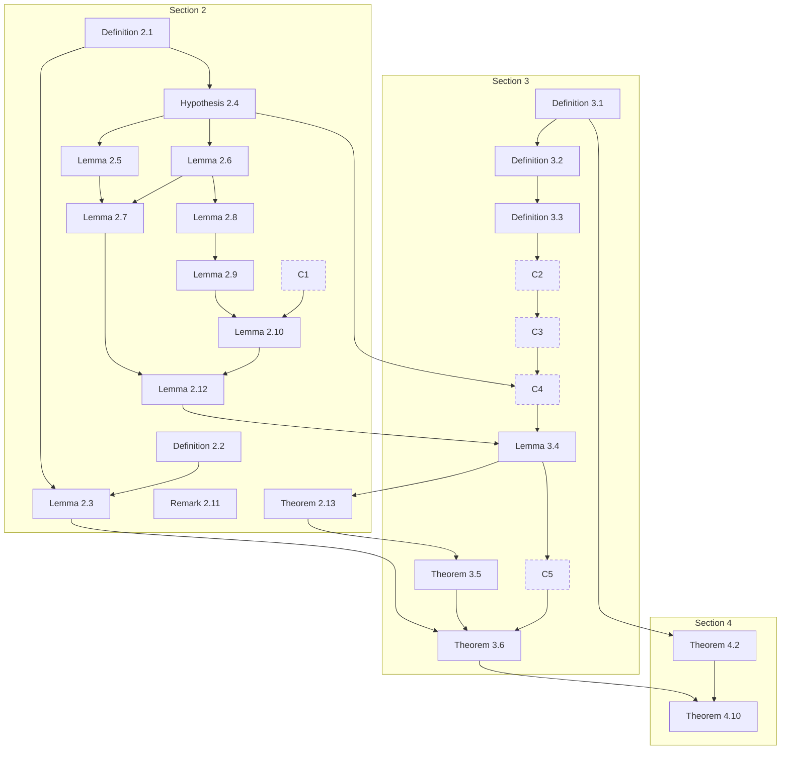
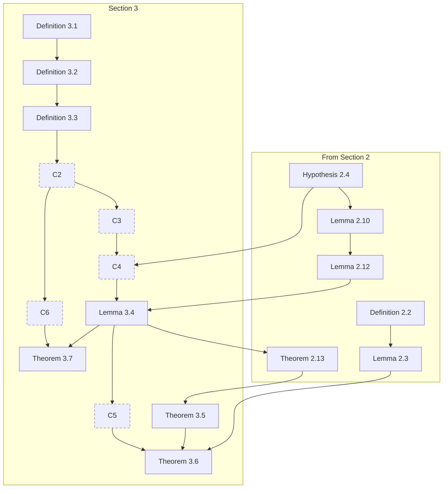
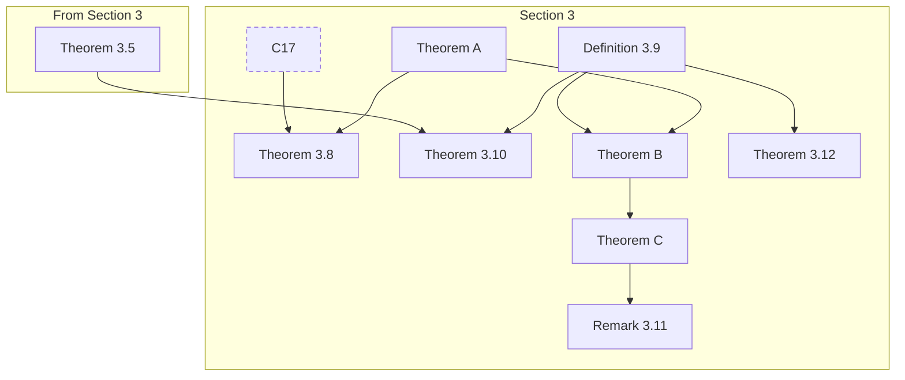
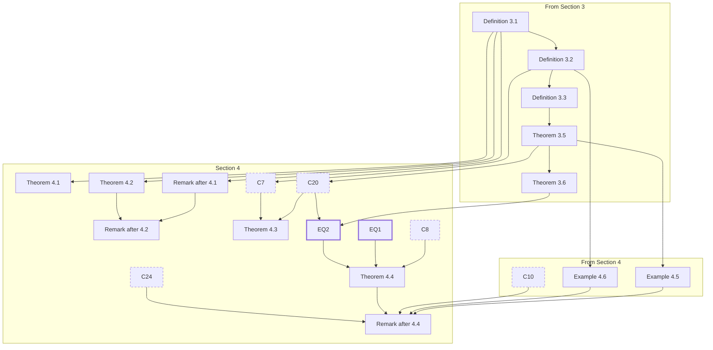
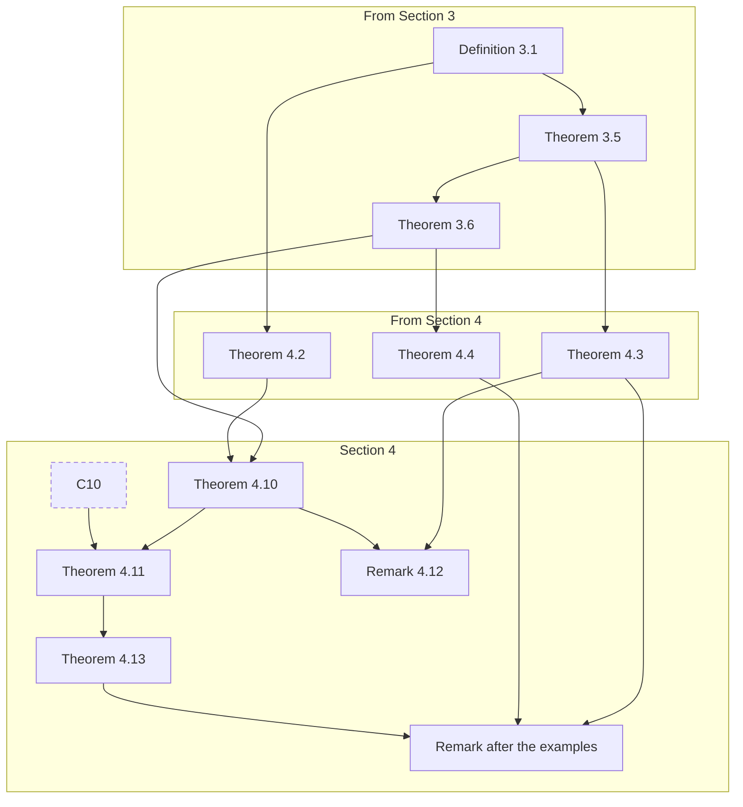
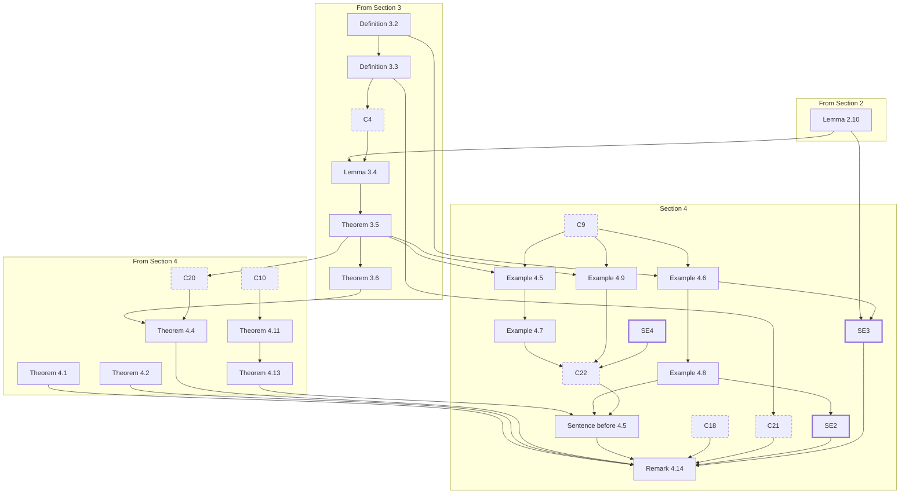
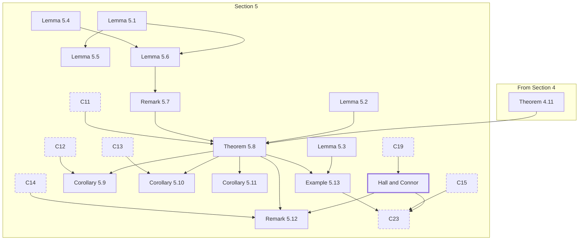
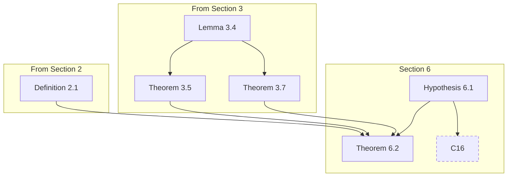
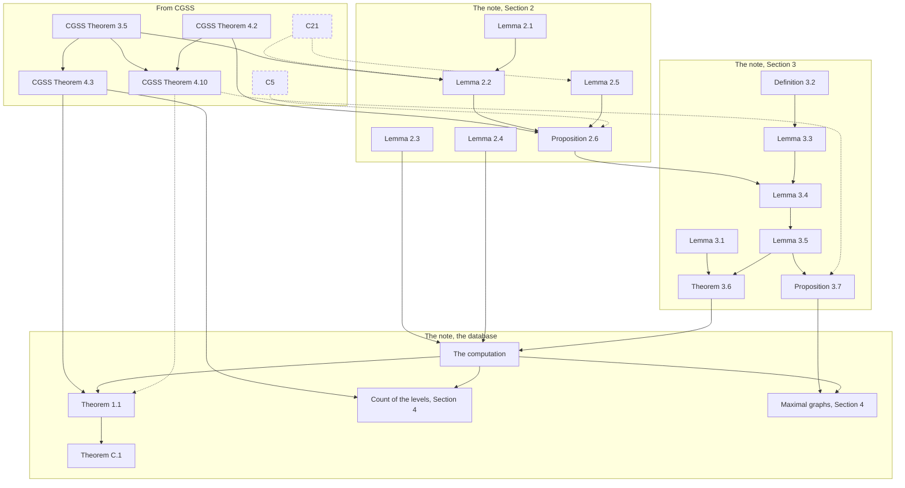

# Dependency diagram

This file shows how the numbered results of [CGSS] depend on each other, in the blueprint and in
the Lean library `LineGraphs`, and how the results of the note [Exc] depend on them. Here [CGSS]
is P. J. Cameron, J. M. Goethals, J. J. Seidel and E. E. Shult, *Line graphs, root systems, and
elliptic geometry*, J. Algebra **43** (1976), 305–327, and [Exc] is our note *A database of
exceptional graphs with least eigenvalue ≥ −2*,
[`exceptional/note/exceptional.tex`](exceptional/note/exceptional.tex). For each result we give
a few words on what it says, its main Lean declarations, the files that contain them, and the
results that its proof uses. The few words only identify a result; the full statements are in the
blueprint ([`blueprint/`](blueprint/)), in [CGSS] and [Exc], and in the Lean files.

In the diagrams, an arrow from A to B means that the proof of B in the blueprint uses A, directly
or through a lemma of the blueprint that the diagram does not show; when that lemma belongs to the
proof of a numbered result, such as the lemma on strongly regular line graphs in the proof of
Theorem 4.13, the arrow starts at that result. To keep the diagrams readable, we leave out an arrow
from A to C whenever a chain of other arrows leads from A to C, and an arrow from a definition
goes only to the results whose proofs work with it, not to every result whose statement mentions
it; the column *Uses* of the tables lists all the results that each proof uses. The Lean proofs
follow the blueprint in most places; where a Lean proof takes another route, for instance through
a computation in place of a theorem, the diagrams show the route of the blueprint. Theorem 3.10
and computation C23 have no structured proof in the blueprint, and their arrows are those of their
Lean proofs.

Besides the numbered results, the diagrams contain the computations C1 to C24, the explicit
calculations on which the proofs rest (dashed boxes); the results of other papers that [CGSS] uses
and that we prove, such as the relative bound EQ1 for equiangular lines (thick boxes); the claims
of Section 4 that carry no number, such as the remark after Theorem 4.1; and Theorems A, B and C of
the blueprint, on which Remark 3.11 rests. A box headed *From Section k* holds the results of
another section that the diagram needs, with the arrows between them. The claims that [CGSS] makes
in passing, such as the remark after Definition 3.1 on the diagonals of the cuboctahedron, are in
Lean in [`LineGraphs/SideClaims/`](LineGraphs/SideClaims/) and
[`LineGraphs/PaperClaims/`](LineGraphs/PaperClaims/), and the diagrams leave them out.

## The main line

The first diagram is the main line of [CGSS]: from the lines at 60° and 90° of Section 2 to the
classification of the indecomposable star-closed sets of lines (Theorem 3.5), to that of the
maximal ones (Theorem 3.6), and to the theorem of Hoffman (Theorem 4.10), with the computations on
which they rest. It contains all of Section 2; Remark 2.11 has no arrows, since it only cites a
result of another paper and has no proof here.



## Section 2: lines at 60° and 90°

The diagram of Section 2 is the upper part of the main line. In Lean, a set of lines at 60° and
90° is a `LineSystem`, recorded by the vectors of squared norm 2 on its lines, and an
indecomposable star-closed one with a star $a$, $b$, $c$, as in Hypothesis 2.4, is a
`LineSystem.Hyp24`, which defines the sets $\Gamma_a$, $\Gamma_b$, $\Gamma_c$ and $\Delta$.

| Result | What it is | Main Lean declarations | File | Uses |
| --- | --- | --- | --- | --- |
| Definition 2.1 | star-closed sets of lines at 60° and 90° | `LineSystem.IsStarClosed` | [LineGraphs/LineSystem/Defs.lean](LineGraphs/LineSystem/Defs.lean) | none |
| Definition 2.2 | maximal sets of lines at 60° and 90° | `LineSystem.IsMaximal` | [LineGraphs/LineSystem/Defs.lean](LineGraphs/LineSystem/Defs.lean) | none |
| Lemma 2.3 | a maximal set of lines is star-closed | `LineSystem.IsMaximal.isStarClosed` | [LineGraphs/LineSystem/Hyp24.lean](LineGraphs/LineSystem/Hyp24.lean) | 2.1, 2.2 |
| Hypothesis 2.4 | an indecomposable star-closed set of lines with a star $a$, $b$, $c$; the sets $\Gamma_a$, $\Gamma_b$, $\Gamma_c$, $\Delta$, $\Sigma$ and the graph on $\Gamma_a$ | `LineSystem.Hyp24`, `LineSystem.Hyp24.orthGraph` | [LineGraphs/LineSystem/Hyp24.lean](LineGraphs/LineSystem/Hyp24.lean) | 2.1 |
| Lemma 2.5 | the lines are those spanned by the vectors of $\Sigma$ | `LineSystem.Hyp24.Φ_eq_sigmaSet_union_neg` | [LineGraphs/LineSystem/Hyp24.lean](LineGraphs/LineSystem/Hyp24.lean) | 2.4 |
| Lemma 2.6 | $\Gamma_a$, $\Gamma_b$ and $\Gamma_c$ are isometric, with no negative inner products | `LineSystem.Hyp24.ΓaEquivΓb`, `LineSystem.Hyp24.ΓbEquivΓc`, `LineSystem.Hyp24.ΓcEquivΓa`, `LineSystem.Hyp24.inner_eq_zero_or_one`, `LineSystem.Hyp24.add_c_mem_Γb`, `LineSystem.Hyp24.sub_b_mem_Γc` | [LineGraphs/LineSystem/Hyp24.lean](LineGraphs/LineSystem/Hyp24.lean) | 2.4 |
| Lemma 2.7 | $\Sigma$ is determined by $\Gamma_a$ and $a$, $b$, $c$ | `LineSystem.Hyp24.Δ_eq_sub`, `LineSystem.Hyp24.Φ_eq_recovery_union_neg`, `LineSystem.Hyp24.Φ_eq_of_Γa_eq` | [LineGraphs/LineSystem/Hyp24.lean](LineGraphs/LineSystem/Hyp24.lean) | 2.4, 2.5, 2.6 |
| Lemma 2.8 | the graph on $\Gamma_a$ has the triangle property | `LineSystem.Hyp24.triangle`, `LineSystem.Hyp24.orthGraph_hasTriangleProperty` | [LineGraphs/LineSystem/Hyp24.lean](LineGraphs/LineSystem/Hyp24.lean), [LineGraphs/LineSystem/TriangleProperty.lean](LineGraphs/LineSystem/TriangleProperty.lean) | 2.4, 2.6 |
| Lemma 2.9 | if a vertex of $\Gamma_a$ is adjacent to all the others, the graph consists of triangles with one common vertex | `LineSystem.Hyp24.orthGraph_iso_friendship_of_forall_adj` | [LineGraphs/LineSystem/TriangleProperty.lean](LineGraphs/LineSystem/TriangleProperty.lean) | 2.4, 2.8 |
| Lemma 2.10 | if the graph on $\Gamma_a$ is nonvoid, noncomplete and not as in Lemma 2.9, then $\Gamma_a$ has 9, 15 or 27 vertices and its graph is strongly regular and unique; with the lemmas on graphs with the triangle property, and the bound of the paper by Gram matrices | `LineSystem.Hyp24.card_Γa_mem`, `LineSystem.Hyp24.orthGraph_isSRGWith`, `LineSystem.Hyp24.orthGraph_iso_of_card_Γa_eq`, `SimpleGraph.HasTriangleProperty.normal_form_of_not_forall_adj`, `SimpleGraph.HasTriangleProperty.nonempty_iso_of_card_eq`, `LineSystem.Hyp24.card_commonNeighbors_le_five_of_gram` | [LineGraphs/LineSystem/OrthGraphParameters.lean](LineGraphs/LineSystem/OrthGraphParameters.lean), [LineGraphs/Graphs/TriangleProperty.lean](LineGraphs/Graphs/TriangleProperty.lean), [LineGraphs/Graphs/TrianglePropertyIso.lean](LineGraphs/Graphs/TrianglePropertyIso.lean), [LineGraphs/LineSystem/OrthGraphGram.lean](LineGraphs/LineSystem/OrthGraphGram.lean) | 2.4, 2.6, 2.8, 2.9, C1 |
| Remark 2.11 | the characterization of the symplectic and orthogonal graphs over $GF(2)$ by the triangle property | none; the remark only points to the characterization of Shult, references [24] and [21] of [CGSS], which is proved in another paper and is outside the scope of the formalization |  | none |
| Lemma 2.12 | the set of lines is determined by its graph on $\Gamma_a$, which is one of five graphs | `LineSystem.Hyp24.orthGraph_cases`, `LineSystem.Iso.ofOrthGraphIso`, `LineSystem.IsIndecomposable.eq_pair_or_exists_hyp24` | [LineGraphs/LineSystem/OrthGraphCases.lean](LineGraphs/LineSystem/OrthGraphCases.lean), [LineGraphs/LineSystem/OrthGraphReconstruction.lean](LineGraphs/LineSystem/OrthGraphReconstruction.lean) | 2.4, 2.5, 2.6, 2.7, 2.9, 2.10 |
| Theorem 2.13 | the five possibilities for an indecomposable star-closed set of lines | `LineSystem.five_possibilities'`, `LineSystem.five_possibilities`, `LineSystem.five_possibilities_forall_hyp24`, `LineSystem.Iso.exists_ambient_isometry_of_same_model` | [LineGraphs/LineSystem/ClassificationModels.lean](LineGraphs/LineSystem/ClassificationModels.lean), [LineGraphs/LineSystem/FivePossibilities.lean](LineGraphs/LineSystem/FivePossibilities.lean), [LineGraphs/LineSystem/Section2Models.lean](LineGraphs/LineSystem/Section2Models.lean) | 2.9, 2.10, 2.12, 3.1, 3.2, 3.3, 3.4, C2, C4 |

## Section 3: root systems

We split Section 3 into two diagrams. The first holds the root systems of Definitions 3.1 to 3.3
and Theorems 3.5 to 3.7, with the results of Section 2 that they use; the second holds Theorems
3.8 to 3.12, on the graphs with largest eigenvalue 2 and on the Root Systems. Theorems A, B and C
are the results of the blueprint on which Remark 3.11 rests: the classification of the
indecomposable Cartan matrices of finite type, the classification of the Root Systems, and the
lines of the Root Systems. The proof of Theorem 3.8 uses the weighted dichotomy from the proof of
Theorem A, so the arrow to Theorem 3.8 starts at Theorem A.





| Result | What it is | Main Lean declarations | File | Uses |
| --- | --- | --- | --- | --- |
| Definition 3.1 | the root systems $A_n$ and $D_n$ | `LineSystem.An`, `LineSystem.Dn` | [LineGraphs/LineSystem/Models.lean](LineGraphs/LineSystem/Models.lean) | none |
| Definition 3.2 | the root system $E_8$, in three models | `LineSystem.E₈viaA₈`, `LineSystem.E₈viaD₈`, `LineSystem.E₈viaSteiner`, `LineSystem.E₈` | [LineGraphs/LineSystem/Models.lean](LineGraphs/LineSystem/Models.lean) | 3.1 |
| Definition 3.3 | $E_7$ and $E_6$, the lines of $E_8$ orthogonal to a line and to a star | `LineSystem.E₇`, `LineSystem.E₆`, `LineSystem.T₇`, `LineSystem.T₆` | [LineGraphs/LineSystem/Models.lean](LineGraphs/LineSystem/Models.lean), [LineGraphs/Computations/C2.lean](LineGraphs/Computations/C2.lean) | 3.2 |
| Lemma 3.4 | the numbers of lines of $A_n$, $D_n$, $E_8$, $E_7$ and $E_6$; with the lemma that $E_7$ and $E_6$ do not depend on the line or the star chosen in Definition 3.3, in each model of $E_8$ | `LineSystem.numLines_An`, `LineSystem.numLines_Dn`, `LineSystem.numLines_E₈`, `LineSystem.numLines_E₈viaA₈`, `LineSystem.numLines_E₈viaSteiner`, `LineSystem.numLines_E₇`, `LineSystem.numLines_E₆`, `LineSystem.E₈.nonempty_iso_E₇_orthogonalTo`, `LineSystem.E₈.nonempty_iso_E₆_orthogonalTo`, `LineSystem.E₈viaA₈.nonempty_iso_E₇_orthogonalTo`, `LineSystem.E₈viaA₈.nonempty_iso_E₆_orthogonalTo`, `LineSystem.E₈viaSteiner.nonempty_iso_E₇_orthogonalTo`, `LineSystem.E₈viaSteiner.nonempty_iso_E₆_orthogonalTo`, `LineSystem.T₇.nonempty_iso_E₇`, `LineSystem.T₆.nonempty_iso_E₆` | [LineGraphs/LineSystem/Models.lean](LineGraphs/LineSystem/Models.lean), [LineGraphs/LineSystem/ClassificationChoices.lean](LineGraphs/LineSystem/ClassificationChoices.lean), [LineGraphs/LineSystem/ClassificationChoicesModels.lean](LineGraphs/LineSystem/ClassificationChoicesModels.lean) | 2.10, 2.12, 3.1, 3.2, 3.3, C2, C3, C4 |
| Theorem 3.5 | the indecomposable star-closed sets of lines are $A_n$, $D_n$, $E_6$, $E_7$ and $E_8$ | `LineSystem.classification`, `LineSystem.exists_iso_rootType` | [LineGraphs/LineSystem/Classification.lean](LineGraphs/LineSystem/Classification.lean) | 2.13, 3.1, 3.2, 3.3, 3.4, C2, C3, C4 |
| Theorem 3.6 | the indecomposable maximal sets of lines are the root systems other than $A_7$, $A_8$ and $D_8$ | `LineSystem.classification_of_isMaximal`, `LineSystem.IsMaximal.exists_iso_rootType` | [LineGraphs/LineSystem/ClassificationMaximal.lean](LineGraphs/LineSystem/ClassificationMaximal.lean) | 2.2, 2.3, 3.4, 3.5, C4, C5 |
| Theorem 3.7 | the matrix $C$ of each root system satisfies a quadratic equation | `LineSystem.signedAdj_quadratic_An`, `LineSystem.signedAdj_quadratic_Dn`, `LineSystem.signedAdj_quadratic_E₈`, `LineSystem.signedAdj_quadratic_E₇`, `LineSystem.signedAdj_quadratic_E₆`, `LineSystem.nonempty_signing` | [LineGraphs/Computations/C6.lean](LineGraphs/Computations/C6.lean), [LineGraphs/LineSystem/Frame.lean](LineGraphs/LineSystem/Frame.lean) | 3.4, C6 |
| Theorem 3.8 | Smith's theorem: the connected graphs with largest eigenvalue 2 are the graphs of Figure 1 | `SimpleGraph.smith`, `SimpleGraph.smith_exists_gram` | [LineGraphs/Cartan/Smith.lean](LineGraphs/Cartan/Smith.lean) | Theorem A, C17 |
| Definition 3.9 | Root Systems, whose roots may have different lengths | `IsRootSet` | [LineGraphs/RootSystems/Defs.lean](LineGraphs/RootSystems/Defs.lean) | none |
| Theorem 3.10 | for a spanning set of lines, the vectors of one length on the lines form a Root System if and only if the lines are at 60° and 90° and star-closed, that is, if and only if they form an orthogonal sum of $A_n$, $D_n$, $E_6$, $E_7$ and $E_8$; the blueprint has no entry for this theorem | `LineSystem.isRootSet_tfae`, `LineSystem.isRootSet_tfae_of_inner_self_eq_two` | [LineGraphs/RootSystems/Correspondence.lean](LineGraphs/RootSystems/Correspondence.lean) | 3.5, 3.9 |
| Remark 3.11, Theorem A | the indecomposable Cartan matrices of finite type; with the weighted dichotomy, which the proof of Theorem 3.8 also uses | `Matrix.IsFiniteCartan.classification`, `Matrix.IsFiniteCartan.classification_type_unique`, `CartanMatrix.isFiniteTypeModel_iff`, `WeightedGraph.affine_or_dynkin` | [LineGraphs/Cartan/Classification.lean](LineGraphs/Cartan/Classification.lean), [LineGraphs/Cartan/Models.lean](LineGraphs/Cartan/Models.lean), [LineGraphs/Cartan/DynkinD.lean](LineGraphs/Cartan/DynkinD.lean) | none |
| Remark 3.11, Theorem B | the classification of the Root Systems | `IsRootSet.classification` | [LineGraphs/RootSetClassification/Classification.lean](LineGraphs/RootSetClassification/Classification.lean) | 3.9, Theorem A |
| Remark 3.11, Theorem C | the lines of the Root Systems: lengths, angles and their quadratic equations | `IsRootSet.remark_lines`, `IsRootSet.exists_rootRepresentatives` | [LineGraphs/RootSetClassification/RemarkLines.lean](LineGraphs/RootSetClassification/RemarkLines.lean), [LineGraphs/RootSetClassification/LineRepresentatives.lean](LineGraphs/RootSetClassification/LineRepresentatives.lean) | 3.9, Theorem B |
| Remark 3.11 | the classification of the Root Systems, completed from Theorems A, B and C; with the Cartan matrices of small rank | `CartanMatrix.small_rank_identifications`, `Matrix.exists_gram_realization` | [LineGraphs/Cartan/SmallRanks.lean](LineGraphs/Cartan/SmallRanks.lean), [LineGraphs/Cartan/GramRealization.lean](LineGraphs/Cartan/GramRealization.lean) | Theorem A, Theorem B, Theorem C |
| Theorem 3.12 | a set of lines at 90°, 60° and 45° lies in the set of lines of a Root System if and only if it splits into two parts, with angles 90° or 60° within a part and 90° or 45° between the parts | `LineSystem.subset_rootSet_iff_bipartition` | [LineGraphs/Theorem312/Main.lean](LineGraphs/Theorem312/Main.lean) | 3.9 |

## Section 4: graphs with least eigenvalue −2

We split Section 4 into three diagrams. The first holds Theorems 4.1 to 4.4, on the graphs
represented in $A_n$, $D_n$ and $E_8$, the second holds Theorems 4.10 to 4.13, and the third holds
the examples and Remark 4.14. The claims of the section that carry no number have nodes of their
own: the remarks after Theorems 4.1, 4.2 and 4.4, the sentence before Example 4.5, which says that
the seven graphs of the examples are not line graphs, and the remark after the examples, which the
blueprint states after Theorem 4.13. In these diagrams, a box headed *From Section 4* holds results
of the section that another of the three diagrams shows.







| Result | What it is | Main Lean declarations | File | Uses |
| --- | --- | --- | --- | --- |
| Theorem 4.1 | a graph is represented in $A_n$ if and only if it is the line graph of a bipartite graph | `SimpleGraph.isRepresentedIn_An_iff` | [LineGraphs/Representation/TypeA.lean](LineGraphs/Representation/TypeA.lean) | 3.1 |
| Remark after Theorem 4.1 | the maximal subsets of $A_n$ with nonnegative inner products represent the graphs $L(K_{m,n+1-m})$, and their sizes | `LineSystem.An.card_nonneg_subset_le`, `LineSystem.An.nonneg_subset_maximal_iff`, `LineSystem.An.exists_nonneg_subset_card_eq`, `LineSystem.An.isRepresentation_lineGraph_completeBipartite_sigmaP` | [LineGraphs/Representation/Remarks.lean](LineGraphs/Representation/Remarks.lean) | 3.1 |
| Theorem 4.2 | a graph is represented in $D_n$ if and only if it is a generalized line graph | `SimpleGraph.isRepresentedIn_Dn_iff`, `SimpleGraph.IsRepresentation.exists_normal_form_Dn` | [LineGraphs/Representation/TypeDNormalForm.lean](LineGraphs/Representation/TypeDNormalForm.lean) | 3.1 |
| Remark after Theorem 4.2 | the maximal subsets of $D_n$ with nonnegative inner products represent generalized line graphs of $K_m$, and their sizes | `LineSystem.Dn.card_nonneg_subset_le`, `LineSystem.Dn.exists_isRepresentation_generalizedLineGraph_top_of_maximal`, `LineSystem.Dn.exists_nonneg_subset_card_eq` | [LineGraphs/Representation/Remarks.lean](LineGraphs/Representation/Remarks.lean) | 3.1, 4.2, the remark after 4.1 |
| Theorem 4.3 | a graph represented in $E_8$ has at most 36 vertices and valency at most 28, and both bounds are attained | `SimpleGraph.IsRepresentedIn.card_le_36`, `SimpleGraph.IsRepresentedIn.degree_le_28`, `SimpleGraph.exists_isRepresentedIn_E₈_card_36` | [LineGraphs/Representation/SymmetricSquare.lean](LineGraphs/Representation/SymmetricSquare.lean), [LineGraphs/Representation/Valency.lean](LineGraphs/Representation/Valency.lean), [LineGraphs/Computations/C7.lean](LineGraphs/Computations/C7.lean) | 3.5, C7, C20 |
| Theorem 4.4 | a regular graph represented in $E_8$ has at most 28 vertices and valency at most 16 | `SimpleGraph.IsRepresentedIn.card_le_28_of_regular`, `SimpleGraph.IsRepresentedIn.degree_le_16_of_regular` | [LineGraphs/Representation/Theorem44Unconditional.lean](LineGraphs/Representation/Theorem44Unconditional.lean) | 3.5, 3.6, C8, C20, EQ1, EQ2 |
| Remark after Theorem 4.4 | no 16-regular graph on 28 vertices is represented in $E_8$, and the bounds of Theorem 4.4 are attained | `SimpleGraph.not_regular_28_16_isRepresentedIn_E₈`, `SimpleGraph.regular_28_12_and_27_16_isRepresentedIn_E₈` | [LineGraphs/Representation/Theorem44Unconditional.lean](LineGraphs/Representation/Theorem44Unconditional.lean), [LineGraphs/Representation/Theorem44.lean](LineGraphs/Representation/Theorem44.lean) | 4.4, 4.5, 4.6, C10, C24, EQ2 |
| Sentence before Example 4.5 | the seven graphs of Examples 4.5 to 4.9 are strongly regular, with least eigenvalue $-2$, and are not line graphs | `SimpleGraph.seidelSeven_not_iso_lineGraph`, `SimpleGraph.seidel_seven_properties` | [LineGraphs/Seidel/Seven.lean](LineGraphs/Seidel/Seven.lean) | 4.5, 4.6, 4.7, 4.8, 4.9, 4.13, C9, C22 |
| Example 4.5 | the three Chang graphs, represented in $E_8$ | `SimpleGraph.changI_isRepresentedIn_E₈`, `SimpleGraph.changII_isRepresentedIn_E₈`, `SimpleGraph.changIII_isRepresentedIn_E₈` | [LineGraphs/Computations/C9ChangI.lean](LineGraphs/Computations/C9ChangI.lean), [LineGraphs/Computations/C9ChangII.lean](LineGraphs/Computations/C9ChangII.lean), [LineGraphs/Computations/C9ChangIII.lean](LineGraphs/Computations/C9ChangIII.lean) | 3.2, 3.5, C9 |
| Example 4.6 | the Schläfli graph, represented in $E_8$ | `SimpleGraph.schlafli_isRepresentedIn_E₈` | [LineGraphs/Computations/C9Schlafli.lean](LineGraphs/Computations/C9Schlafli.lean) | 3.2, C9 |
| Example 4.7 | the Shrikhande graph, represented in $E_8$, and a subgraph of Chang I | `SimpleGraph.shrikhande_isRepresentedIn_E₈`, `SimpleGraph.shrikhande.nonempty_iso_induce_changI` | [LineGraphs/Computations/C9Shrikhande.lean](LineGraphs/Computations/C9Shrikhande.lean), [LineGraphs/Computations/C9Subgraphs.lean](LineGraphs/Computations/C9Subgraphs.lean) | 3.2, 3.5, 4.5, C9 |
| Example 4.8 | the Clebsch graph, represented in $E_8$, and a subgraph of the Schläfli graph | `SimpleGraph.clebsch_isRepresentedIn_E₈`, `SimpleGraph.clebsch.nonempty_iso_induce_schlafli` | [LineGraphs/Computations/C9Clebsch.lean](LineGraphs/Computations/C9Clebsch.lean), [LineGraphs/Computations/C9Subgraphs.lean](LineGraphs/Computations/C9Subgraphs.lean) | 3.2, 4.6, C9 |
| Example 4.9 | the Petersen graph, represented in $E_8$ | `SimpleGraph.petersen_isRepresentedIn_E₈` | [LineGraphs/Computations/C9Petersen.lean](LineGraphs/Computations/C9Petersen.lean) | 3.2, 3.5, C9 |
| Theorem 4.10 | Hoffman: a connected graph with least eigenvalue at least $-2$ is a generalized line graph or is represented in $E_8$ | `SimpleGraph.hoffman` | [LineGraphs/Representation/Hoffman.lean](LineGraphs/Representation/Hoffman.lean) | 3.1, 3.5, 3.6, 4.2 |
| Theorem 4.11 | Hoffman and Ray-Chaudhuri: a connected regular graph with least eigenvalue at least $-2$ is a line graph or a cocktail party graph, or is represented in $E_8$ | `SimpleGraph.hoffman_rayChaudhuri` | [LineGraphs/Representation/HoffmanRegular.lean](LineGraphs/Representation/HoffmanRegular.lean) | 4.10, C10 |
| Remark 4.12 | claws: the connected generalized line graphs without 3-claws, those without 4-claws, and the large graphs without 3-claws with least eigenvalue at least $-2$ | `SimpleGraph.IsGeneralizedLineGraph.clawFree_iff`, `SimpleGraph.generalizedLineGraph_fourClawFree_iff`, `SimpleGraph.hoffman_of_clawFree` | [LineGraphs/Representation/ClawsClassification.lean](LineGraphs/Representation/ClawsClassification.lean), [LineGraphs/Representation/ClawsCriteria.lean](LineGraphs/Representation/ClawsCriteria.lean) | 4.3, 4.10 |
| Theorem 4.13 | Seidel: a connected strongly regular graph with least eigenvalue $-2$ is $L(K_n)$, $L(K_{n,n})$ or $CP(n)$, or is represented in $E_8$; with the lemma on strongly regular line graphs (LG1) behind it | `SimpleGraph.seidel`, `SimpleGraph.lineGraph_isSRGWith_cases` | [LineGraphs/Representation/Seidel413.lean](LineGraphs/Representation/Seidel413.lean), [LineGraphs/Seidel/LineGraphCases.lean](LineGraphs/Seidel/LineGraphCases.lean) | 4.11, C10 |
| Remark after the examples | Theorems 4.10, 4.11 and 4.13 without their case "represented in $E_8$", for graphs with too many vertices or too large a valency, by Theorems 4.3 and 4.4 | `SimpleGraph.hoffman_of_large`, `SimpleGraph.hoffman_rayChaudhuri_of_large`, `SimpleGraph.seidel_of_large` | [LineGraphs/Representation/Hoffman.lean](LineGraphs/Representation/Hoffman.lean), [LineGraphs/Representation/HoffmanRegular.lean](LineGraphs/Representation/HoffmanRegular.lean), [LineGraphs/Representation/Seidel413.lean](LineGraphs/Representation/Seidel413.lean) | 4.3, 4.4, 4.10, 4.11, 4.13 |
| Remark 4.14 | Seidel: the graphs of Theorem 4.13 represented in $E_8$, other than $L(K_n)$, $L(K_{n,n})$ and $CP(n)$, are the seven graphs of Examples 4.5 to 4.9 | `SimpleGraph.seidel_seven`, `SimpleGraph.seidel_seven_classification`, `SimpleGraph.seidel_seven_pairwise_not_iso` | [LineGraphs/Seidel/Classification.lean](LineGraphs/Seidel/Classification.lean), [LineGraphs/Seidel/SevenDistinct.lean](LineGraphs/Seidel/SevenDistinct.lean) | 3.2, 3.3, 3.4, 3.5, 3.6, 4.1, 4.2, 4.4, 4.5, 4.7, 4.9, 4.11, 4.13, the sentence before 4.5, C4, C10, C18, C20, C21, C22, SE2, SE3, SE4 |

## Section 5: spectral characterization of certain graphs

Lemmas 5.1 to 5.4 rest on the spectral toolkit
([`cgss/proofs/spectraltools/spectraltools.tex`](cgss/proofs/spectraltools/spectraltools.tex), in Lean in
[`LineGraphs/Spectral/`](LineGraphs/Spectral/)), which the diagram does not show.



| Result | What it is | Main Lean declarations | File | Uses |
| --- | --- | --- | --- | --- |
| Lemma 5.1 | the largest eigenvalue of a regular graph is its valency, with multiplicity the number of components | `SimpleGraph.IsRegularOfDegree.largestEigenvalue_eq`, `SimpleGraph.IsRegularOfDegree.multiplicity_eq_card_components` | [LineGraphs/Spectral/Regular.lean](LineGraphs/Spectral/Regular.lean) | none |
| Lemma 5.2 | a graph on $n$ vertices is regular if and only if the sum of the squares of its eigenvalues is $n\lambda_1$ | `SimpleGraph.isRegular_iff_sum_sq_eigenvalues` | [LineGraphs/Spectral/Regularity.lean](LineGraphs/Spectral/Regularity.lean) | none |
| Lemma 5.3 | a connected $k$-regular graph is bipartite if and only if $-k$ is an eigenvalue, and then $-k$ is simple | `SimpleGraph.IsRegularOfDegree.isBipartite_iff_neg_eigenvalue`, `SimpleGraph.IsRegularOfDegree.multiplicity_neg_eq_one` | [LineGraphs/Spectral/Regular.lean](LineGraphs/Spectral/Regular.lean) | none |
| Lemma 5.4 | if $L(X)$ is regular and connected, then $X$ is regular, or bipartite with constant valency on each part | `SimpleGraph.regular_or_isBiregularWith_of_lineGraph_regular` | [LineGraphs/Spectral/LineGraphRegular.lean](LineGraphs/Spectral/LineGraphRegular.lean) | none |
| Lemma 5.5 | the spectrum of a regular graph is determined by the spectrum of its line graph | `SimpleGraph.cospectral_of_lineGraph_cospectral` | [LineGraphs/Spectral/LineGraphRecovery.lean](LineGraphs/Spectral/LineGraphRecovery.lean) | 5.1 |
| Lemma 5.6 | the graphs whose line graphs are cospectral with the regular line graph of a connected bipartite graph | `SimpleGraph.lineGraph_cospectral_bipartite_forall_isBiregularWith` | [LineGraphs/LineGraphSpectra/Bipartite.lean](LineGraphs/LineGraphSpectra/Bipartite.lean) | 5.1, 5.4 |
| Remark 5.7 | the spectrum in case (ii) of Lemma 5.6 | `SimpleGraph.lineGraph_cospectral_bipartite_spectrum_of_not_isBipartite` | [LineGraphs/LineGraphSpectra/Nonbipartite.lean](LineGraphs/LineGraphSpectra/Nonbipartite.lean) | 5.1, 5.6 |
| Theorem 5.8 | the graphs cospectral with the flag graph of a 2-design: three cases | `Design.flagGraph_cospectral` | [LineGraphs/LineGraphSpectra/Theorem58.lean](LineGraphs/LineGraphSpectra/Theorem58.lean) | 4.11, 5.1, 5.2, 5.6, 5.7, C11 |
| Corollary 5.9 | Doob: for $m+n>9$, $L(K_{m,n})$ is characterized by its spectrum, apart from the exceptions given by symmetric Hadamard matrices with constant diagonal | `SimpleGraph.lineGraph_completeBipartite_characterized` | [LineGraphs/LineGraphSpectra/Corollaries.lean](LineGraphs/LineGraphSpectra/Corollaries.lean) | 5.8, C12 |
| Corollary 5.10 | Hoffman and Ray-Chaudhuri: the flag graph of a symmetric design with $k<v$ is characterized by its spectrum unless the design is $(4,3,2)$, and for $(4,3,2)$ it is not | `Design.IsSymmetric.flagGraphCharacterized`, `Computations.C13.not_flagGraphCharacterized` | [LineGraphs/LineGraphSpectra/Corollaries.lean](LineGraphs/LineGraphSpectra/Corollaries.lean), [LineGraphs/Computations/C13Characterization.lean](LineGraphs/Computations/C13Characterization.lean) | 5.8, C13 |
| Corollary 5.11 | Doob: the flag graph of a 2-design with $\lambda=1$ is characterized by its spectrum | `Design.flagGraphCharacterized_of_lam_eq_one` | [LineGraphs/LineGraphSpectra/Corollaries.lean](LineGraphs/LineGraphSpectra/Corollaries.lean) | 5.8 |
| Remark 5.12 | the flag graphs of nontrivial 2-designs with $2<\lambda<19$ are characterized by their spectra; the trivial design $(6,6,10,10,10)$ is an exception | `Design.flagGraphCharacterized_of_lam_lt_nineteen`, `Computations.TrivialDesignException.flagGraph_cospectral_double_lineGraph`, `Computations.TrivialDesignException.flagGraph_not_nonempty_iso_double_lineGraph`, `Computations.TrivialDesignException.not_flagGraphCharacterized` | [LineGraphs/LineGraphSpectra/Remark512.lean](LineGraphs/LineGraphSpectra/Remark512.lean), [LineGraphs/Computations/TrivialDesignException.lean](LineGraphs/Computations/TrivialDesignException.lean) | 5.8, C14, Hall and Connor |
| Example 5.13 | a resolvable design $D'$ gives designs $D_1$ whose flag graphs are not characterized by their spectra | `Design.not_flagGraphCharacterized_of_resolvable` | [LineGraphs/LineGraphSpectra/Example513.lean](LineGraphs/LineGraphSpectra/Example513.lean) | 5.1, 5.3, 5.8 |

## Section 6: an application to Hadamard matrices

Theorem 6.2 applies the classification of Section 3 to the lines that the rows of a Hadamard
matrix define.



| Result | What it is | Main Lean declarations | File | Uses |
| --- | --- | --- | --- | --- |
| Hypothesis 6.1 | any four rows of a Hadamard matrix of order $n$ agree in $\frac18n$ or $\frac18(n\pm x)$ places | `Matrix.IsHadamard.FourRowAgreement` | [LineGraphs/Hadamard/Pairs.lean](LineGraphs/Hadamard/Pairs.lean) | none |
| Theorem 6.2 | there is no Hadamard matrix of order $n>2$ in which any four rows agree in $\frac1{16}n$, $\frac18n$ or $\frac3{16}n$ places | `Matrix.IsHadamard.not_fourRow_agree_sixteenths` | [LineGraphs/Hadamard/Unconditional.lean](LineGraphs/Hadamard/Unconditional.lean) | 2.1, 3.4, 3.5, 3.7, 6.1 |

## The computations C1 to C24

The computations are the explicit calculations of [CGSS] and of the blueprint, such as the Gram
matrices and the numbers of lines of the root systems, each a theorem of the Lean library; the
scripts in [`cgss/certificates/`](cgss/certificates/) check them independently in SageMath. The column *Used by* gives
the results whose proofs use each one.

| Computation | What it checks | Main Lean declarations | File | Uses | Used by |
| --- | --- | --- | --- | --- | --- |
| C1 | the determinant $2k^5(5-k)$ of the $4\times4$ minor of the block-sum matrix (Lemma 2.10) | `Computations.C1.det_blockSumMinor` | [LineGraphs/Computations/C1.lean](LineGraphs/Computations/C1.lean) | none | 2.10 |
| C2 | the models as sets of integer vectors, and their numbers of lines (Lemma 3.4) | `Computations.C2.model_presentations`, `Computations.C2.line_counts`, `LineSystem.numLines_T₇`, `LineSystem.numLines_T₆` | [LineGraphs/Computations/C2.lean](LineGraphs/Computations/C2.lean) | 3.1, 3.2, 3.3 | 2.13, 3.4, 3.5, C3, C4, C6 |
| C3 | the three models of $E_8$ are isomorphic (Definition 3.2, Theorem 3.5) | `LineSystem.E₈viaA₈.isoE₈`, `LineSystem.E₈viaSteiner.isoE₈` | [LineGraphs/Computations/C3A.lean](LineGraphs/Computations/C3A.lean), [LineGraphs/Computations/C3Steiner.lean](LineGraphs/Computations/C3Steiner.lean) | 3.2, C2 | 3.4, 3.5, C4, C5 |
| C4 | the models are star-closed and indecomposable, with their graphs on $\Gamma_a$ and the sizes of $\Gamma_a$ and $\Delta$ (Theorems 2.13 and 3.5) | `Computations.C4.model_data`, `Computations.C4.marked_star_data`, `Computations.C4.exceptional_star_data` | [LineGraphs/Computations/C4.lean](LineGraphs/Computations/C4.lean) | 2.4, 3.1, 3.2, 3.3, C2, C3 | 2.13, 3.4, 3.5, 3.6, 4.14, C5 |
| C5 | the inclusions $A_8\subset E_8$, $D_8\subset E_8$, $A_7\subset E_7$, and the obstructions to the others (Theorem 3.6) | `Computations.C5.inclusions_and_obstructions`, `LineSystem.not_embeds_An_Dn` | [LineGraphs/Computations/C5.lean](LineGraphs/Computations/C5.lean) | 2.10, 3.1, 3.2, 3.3, 3.4, C3, C4 | 3.6 |
| C6 | the identity $\sum\mathbf v\mathbf v^T=\frac{2N}{n}I$ on the span, over one vector $\mathbf v$ on each of the $N$ lines of a model of rank $n$ (Theorem 3.7) | `Computations.C6.coordinate_frame_matrices` | [LineGraphs/Computations/C6.lean](LineGraphs/Computations/C6.lean) | 3.1, 3.2, 3.3, C2 | 3.7 |
| C7 | the 36 vectors of $E_8$ that represent a graph on 36 vertices with a vertex of valency 28 (Theorem 4.3) | `Computations.C7.isRepresentedIn_E₈` | [LineGraphs/Computations/C7.lean](LineGraphs/Computations/C7.lean) | 3.1, 3.2 | 4.3 |
| C8 | the quadratic bound of the proof of Theorem 4.4 | `Computations.C8.quadratic_bound` | [LineGraphs/Computations/C8.lean](LineGraphs/Computations/C8.lean) | none | 4.4 |
| C9 | the parameters of the seven strongly regular graphs of Examples 4.5 to 4.9, and the relations between them | `SimpleGraph.changI_isSRGWith`, `SimpleGraph.changII_isSRGWith`, `SimpleGraph.changIII_isSRGWith`, `SimpleGraph.schlafli_isSRGWith`, `SimpleGraph.shrikhande_isSRGWith`, `SimpleGraph.clebsch_isSRGWith`, `SimpleGraph.petersen_isSRGWith`, `SimpleGraph.clebsch.foldedFiveCubeComplIso`, `SimpleGraph.schlafli.gq24ComplIso`, `SimpleGraph.petersen.kneserIso`, `SimpleGraph.clebsch_isSwitchingEquivalent_shrikhande`, `SimpleGraph.clebsch_isSwitchingEquivalent_lineGraph_completeBipartite` | [LineGraphs/Computations/C9ChangI.lean](LineGraphs/Computations/C9ChangI.lean), [LineGraphs/Computations/C9ChangII.lean](LineGraphs/Computations/C9ChangII.lean), [LineGraphs/Computations/C9ChangIII.lean](LineGraphs/Computations/C9ChangIII.lean), [LineGraphs/Computations/C9Schlafli.lean](LineGraphs/Computations/C9Schlafli.lean), [LineGraphs/Computations/C9Shrikhande.lean](LineGraphs/Computations/C9Shrikhande.lean), [LineGraphs/Computations/C9Clebsch.lean](LineGraphs/Computations/C9Clebsch.lean), [LineGraphs/Computations/C9Petersen.lean](LineGraphs/Computations/C9Petersen.lean), [LineGraphs/Computations/C9ModelIsos.lean](LineGraphs/Computations/C9ModelIsos.lean), [LineGraphs/Computations/C9PetersenIso.lean](LineGraphs/Computations/C9PetersenIso.lean), [LineGraphs/Computations/C9Switching.lean](LineGraphs/Computations/C9Switching.lean) | none | 4.5, 4.6, 4.7, 4.8, 4.9, the sentence before 4.5, SE2, SE3 |
| C10 | the valencies of the vertices of a generalized line graph (Theorem 4.11) | `SimpleGraph.generalizedLineGraph_degree_edge`, `SimpleGraph.generalizedLineGraph_degree_petal` | [LineGraphs/Computations/C10.lean](LineGraphs/Computations/C10.lean) | none | 4.11, 4.13, 4.14, the remark after 4.4 |
| C11 | the algebra of the parameters of Theorem 5.8, and the spectrum in its case (iii) | `Computations.C11.parameters`, `Computations.C11.two_mul_sub_one_le`, `Computations.C11.spectrum_of_parameters` | [LineGraphs/Computations/C11.lean](LineGraphs/Computations/C11.lean), [LineGraphs/Computations/C11Spectrum.lean](LineGraphs/Computations/C11Spectrum.lean) | none | 5.8 |
| C12 | the bordering that gives a symmetric Hadamard matrix of order $4t^2$ with constant diagonal (Corollary 5.9) | `Computations.C12.full_block_parameters`, `Computations.C12.hadamard_border` | [LineGraphs/Computations/C12.lean](LineGraphs/Computations/C12.lean) | none | 5.9 |
| C13 | the two graphs of the exception of Corollary 5.10: cospectral, not isomorphic, and the first is the flag graph of the $(4,3,2)$ design | `Computations.C13.cospectral`, `Computations.C13.not_nonempty_iso`, `Computations.C13.nonempty_iso_flagGraph` | [LineGraphs/Computations/C13.lean](LineGraphs/Computations/C13.lean), [LineGraphs/Computations/C13Design.lean](LineGraphs/Computations/C13Design.lean) | none | 5.10 |
| C14 | in case (iii) of Theorem 5.8, $t=2$ forces $s=3$ or $s=5$, and $t\ge3$ forces $\lambda\ge19$ (Remark 5.12) | `Computations.C14.lambda_ge_nineteen`, `Computations.C14.eq_three_or_five` | [LineGraphs/Computations/C14.lean](LineGraphs/Computations/C14.lean) | none | 5.12 |
| C15 | for $k=2$, the flag graph of the $(6,3,10,5,2)$ design is cospectral with $L(L(\text{Petersen}))$ and not isomorphic to it (Example 5.13) | `Computations.C15.flagGraph_cospectral_double_lineGraph`, `Computations.C15.flagGraph_not_nonempty_iso_double_lineGraph` | [LineGraphs/Computations/C15Result.lean](LineGraphs/Computations/C15Result.lean) | none | C23 |
| C16 | Hypothesis 6.1 for Hadamard matrices of orders 2, 4, 8, 12 and 16, and the 66 lines of the matrix of order 12 (the remarks after Theorem 6.2) | `Computations.C16.fourRow_agreements`, `Computations.C16.checkFourRowAgreement_sound`, `Computations.C16.h12_numLines` | [LineGraphs/Computations/C16.lean](LineGraphs/Computations/C16.lean), [LineGraphs/Computations/C16Checker.lean](LineGraphs/Computations/C16Checker.lean), [LineGraphs/Computations/C16Geometry.lean](LineGraphs/Computations/C16Geometry.lean) | 6.1 | the remarks after 6.2 |
| C17 | the Smith graphs have largest eigenvalue 2, and deleting one vertex leaves a basis (Theorem 3.8) | `SimpleGraph.smith_gram_delete_basis`, `SimpleGraph.smithA_maxRayleigh`, `SimpleGraph.smithD_maxRayleigh`, `SimpleGraph.smithE₆_maxRayleigh`, `SimpleGraph.smithE₇_maxRayleigh`, `SimpleGraph.smithE₈_maxRayleigh` | [LineGraphs/Cartan/SmithGram.lean](LineGraphs/Cartan/SmithGram.lean) | none | 3.8 |
| C18 | the 15 parameter sets of strongly regular graphs with least eigenvalue $-2$, at most 36 vertices, valency at most 16 and $\operatorname{rk}(2I+A)\le8$ (Remark 4.14) | `Computations.C18.srg_parameters` | [LineGraphs/Computations/C18.lean](LineGraphs/Computations/C18.lean) | none | 4.14 |
| C19 | in a 2-(15,5,2) design two blocks meet in 1 or 2 points; the certificates for the matrix of Connor; and $49\cdot5^{21}$ is not a square (Hall and Connor) | `Computations.C19.claw_quadratic`, `Computations.C19.not_sq_eq_49_mul_5_pow_21` | [LineGraphs/Computations/C19.lean](LineGraphs/Computations/C19.lean), [LineGraphs/Computations/C19Arithmetic.lean](LineGraphs/Computations/C19Arithmetic.lean) | none | Hall and Connor |
| C20 | the numbers of roots with inner product 1 with a given root, in $A_\ell$, $D_\ell$, $E_6$, $E_7$, $E_8$, and the pairs at the apex (Theorems 4.3, 4.4, Remark 4.14) | `LineSystem.An.card_N`, `LineSystem.Dn.card_N`, `LineSystem.E₆.card_N`, `LineSystem.E₇.card_N`, `LineSystem.E₈.card_N`, `LineSystem.E₆.N_c`, `LineSystem.E₇.N_c`, `LineSystem.E₈.N_c` | [LineGraphs/Computations/C20Classical.lean](LineGraphs/Computations/C20Classical.lean), [LineGraphs/Computations/C20E6.lean](LineGraphs/Computations/C20E6.lean), [LineGraphs/Computations/C20E7.lean](LineGraphs/Computations/C20E7.lean), [LineGraphs/Computations/C20E8.lean](LineGraphs/Computations/C20E8.lean), [LineGraphs/Computations/C20Apex.lean](LineGraphs/Computations/C20Apex.lean) | 3.1, 3.2, 3.3, 3.5 | 4.3, 4.4, 4.14, EQ2 |
| C21 | bases of simple roots of $E_6$, $E_7$, $E_8$, with Gram determinants 3, 2 and 1 (Remark 4.14) | `Computations.C21.e6_gram_det`, `Computations.C21.e7_gram_det`, `Computations.C21.e8_gram_det`, `Computations.C21.e6_gram_eq_cartan`, `Computations.C21.e7_gram_eq_cartan`, `Computations.C21.e8_gram_eq_cartan`, `LineSystem.E₆.det_gram_simpleRoot`, `LineSystem.E₇.det_gram_simpleRoot`, `LineSystem.E₈.det_gram_simpleRoot` | [LineGraphs/Computations/C21E6.lean](LineGraphs/Computations/C21E6.lean), [LineGraphs/Computations/C21E7.lean](LineGraphs/Computations/C21E7.lean), [LineGraphs/Computations/C21E8.lean](LineGraphs/Computations/C21E8.lean) | 3.2, 3.3 | 4.14 |
| C22 | the regular switchings of $T(5)$, of $T(6)$ with an isolated vertex, and of $T(8)$, with isomorphism certificates and invariants (Remark 4.14) | `Computations.C22.e6_switch_cycle5`, `Computations.C22.e7_switch_cycle6`, `Computations.C22.e7_switch_twoC3`, `Computations.C22.e8_switch_fourK2`, `Computations.C22.e8_switch_twoC4`, `Computations.C22.e8_switch_cube`, `Computations.C22.e8_switch_twoDiamonds`, `Computations.C22.e8_switch_cycle8`, `Computations.C22.e8_switch_wagner`, `Computations.C22.e8_switch_twiceTruncatedK4`, `Computations.C22.e8_switch_cycleThreeFive`, `Computations.C22.e8_switch_truncatedK33`, `Computations.C22.e8_switch_twoK4`, `Computations.C22.e8_switch_empty`, `Computations.C22.cliqueProfile_t8`, `Computations.C22.cliqueProfile_changI`, `Computations.C22.cliqueProfile_changII`, `Computations.C22.cliqueProfile_changIII`, `Computations.C22.cliqueCount_shrikhande`, `Computations.C22.cliqueCount_lineGraph_completeBipartite` | [LineGraphs/Computations/C22E6Cycle5.lean](LineGraphs/Computations/C22E6Cycle5.lean), [LineGraphs/Computations/C22E7Cycle6.lean](LineGraphs/Computations/C22E7Cycle6.lean), [LineGraphs/Computations/C22E7TwoC3.lean](LineGraphs/Computations/C22E7TwoC3.lean), [LineGraphs/Computations/C22E8FourK2.lean](LineGraphs/Computations/C22E8FourK2.lean), [LineGraphs/Computations/C22E8TwoC4.lean](LineGraphs/Computations/C22E8TwoC4.lean), [LineGraphs/Computations/C22E8Cube.lean](LineGraphs/Computations/C22E8Cube.lean), [LineGraphs/Computations/C22E8TwoDiamonds.lean](LineGraphs/Computations/C22E8TwoDiamonds.lean), [LineGraphs/Computations/C22E8Cycle8.lean](LineGraphs/Computations/C22E8Cycle8.lean), [LineGraphs/Computations/C22E8Wagner.lean](LineGraphs/Computations/C22E8Wagner.lean), [LineGraphs/Computations/C22E8TwiceTruncatedK4.lean](LineGraphs/Computations/C22E8TwiceTruncatedK4.lean), [LineGraphs/Computations/C22E8CycleThreeFive.lean](LineGraphs/Computations/C22E8CycleThreeFive.lean), [LineGraphs/Computations/C22E8TruncatedK33.lean](LineGraphs/Computations/C22E8TruncatedK33.lean), [LineGraphs/Computations/C22E8TwoK4.lean](LineGraphs/Computations/C22E8TwoK4.lean), [LineGraphs/Computations/C22TriangularModel.lean](LineGraphs/Computations/C22TriangularModel.lean), [LineGraphs/Computations/C22ChangIModel.lean](LineGraphs/Computations/C22ChangIModel.lean), [LineGraphs/Computations/C22ChangIIModel.lean](LineGraphs/Computations/C22ChangIIModel.lean), [LineGraphs/Computations/C22ChangIIIModel.lean](LineGraphs/Computations/C22ChangIIIModel.lean), [LineGraphs/Computations/C22ShrikhandeModel.lean](LineGraphs/Computations/C22ShrikhandeModel.lean), [LineGraphs/Computations/C22BipartiteModel.lean](LineGraphs/Computations/C22BipartiteModel.lean) | 4.5, 4.7, 4.9, SE4 | 4.14, the sentence before 4.5 |
| C23 | the instances of Example 5.13: the designs $(6,3,10,5,2)$ and $(28,21,36,27,20)$, whose flag graphs are not characterized, the graph $H$ for $k=2$, and for $k=3$ the design $D_1$ does not exist | `Computations.C23.not_flagGraphCharacterized_6_3_10_5_2`, `Computations.C23.not_flagGraphCharacterized_28_21_36_27_20`, `Computations.C23.false_of_parameters_three`, `Computations.C23.nonempty_iso_pairGraph`, `Computations.C23.nonempty_iso_petersen_lineGraph` | [LineGraphs/Computations/C23.lean](LineGraphs/Computations/C23.lean) | 5.13, C15, Hall and Connor | none; it proves the instances of Example 5.13 |
| C24 | the trace inequality that forces $\operatorname{rk}(2I+A)=8$ for a 16-regular graph on 28 vertices (the remark after Theorem 4.4) | `Computations.C24.trace_sq_gt` | [LineGraphs/Computations/C24.lean](LineGraphs/Computations/C24.lean) | none | the remark after 4.4 |

## Results of other papers that we prove

[CGSS] uses these results of other papers, and the library proves them. Their sources, and the
routes that we follow, are in [`cgss/prerequisites.md`](cgss/prerequisites.md). Two more results
of this kind are parts of rows above: the lemmas on graphs with the triangle property behind Lemma
2.10, which amount to the classification of the generalized quadrangles with lines of size 3, and
the lemma on strongly regular line graphs in the proof of Theorem 4.13.

| Result | What it is | Main Lean declarations | File | Uses | Used by |
| --- | --- | --- | --- | --- | --- |
| EQ1 | the relative bound for equiangular lines, of Lemmens and Seidel | `InnerProductSpace.card_le_relativeBound` | [LineGraphs/Representation/Theorem44.lean](LineGraphs/Representation/Theorem44.lean) | none | 4.4 |
| EQ2 | lines at angle $\arccos\frac13$ that span a space of dimension 8 number at most 14; [CGSS] takes this from Lemmens and Seidel, and our proof goes through Theorem 3.5; the Lean of Theorem 4.4 uses the second declaration, which takes the classification as a hypothesis | `InnerProductSpace.card_le_fourteen_of_finrank_eq_eight`, `InnerProductSpace.card_le_fourteen_of_finrank_eq_eight_of_classification` | [LineGraphs/Spectral/RelativeBoundFourteen.lean](LineGraphs/Spectral/RelativeBoundFourteen.lean), [LineGraphs/Representation/Theorem44.lean](LineGraphs/Representation/Theorem44.lean) | 3.5, 3.6, C20 | 4.4, the remark after 4.4 |
| SE2 | a strongly regular graph with parameters $(16,10,6,6)$ is the Clebsch graph | `SimpleGraph.IsSRGWith.nonempty_iso_clebsch`, `SimpleGraph.IsSRGWith.nonempty_iso_foldedFiveCube` | [LineGraphs/Seidel/Clebsch.lean](LineGraphs/Seidel/Clebsch.lean) | 4.8, C9 | 4.14 |
| SE3 | a strongly regular graph with parameters $(27,16,10,8)$ is the Schläfli graph, through the lemmas on graphs with the triangle property of Lemma 2.10 | `SimpleGraph.IsSRGWith.nonempty_iso_schlafli`, `SimpleGraph.IsSRGWith.nonempty_iso_gq24` | [LineGraphs/Seidel/Schlafli.lean](LineGraphs/Seidel/Schlafli.lean) | 2.10, 4.6, C9 | 4.14 |
| SE4 | the regular graphs of valency 2 and 3 on 8 vertices | `SimpleGraph.IsRegularOfDegree.nonempty_iso_of_two_of_card_eq_eight`, `SimpleGraph.IsRegularOfDegree.nonempty_iso_of_three_of_card_eq_eight`, `SimpleGraph.cubic_eight_pairwise_not_iso` | [LineGraphs/Seidel/EightRegular.lean](LineGraphs/Seidel/EightRegular.lean), [LineGraphs/Seidel/CubicEight.lean](LineGraphs/Seidel/CubicEight.lean), [LineGraphs/Seidel/EightInvariants.lean](LineGraphs/Seidel/EightInvariants.lean) | none | 4.14, C22 |
| Hall and Connor | there is no 2-(15,5,2) design, by the embedding theorem of Hall and Connor and the theorem of Bruck, Ryser and Chowla for $v=22$, and so no design $(15,10,21,14,9)$, its complement | `Design.not_nonempty_15_5_2`, `Design.hall_connor`, `Matrix.bruck_ryser_chowla_twenty_two`, `Design.not_nonempty_15_10_9` | [LineGraphs/Cited/HallConnor/Nonexistence.lean](LineGraphs/Cited/HallConnor/Nonexistence.lean), [LineGraphs/Cited/HallConnor/ExtensionMatrix.lean](LineGraphs/Cited/HallConnor/ExtensionMatrix.lean), [LineGraphs/Cited/HallConnor/BruckRyserChowla.lean](LineGraphs/Cited/HallConnor/BruckRyserChowla.lean), [LineGraphs/Cited/HallConnor/Complement.lean](LineGraphs/Cited/HallConnor/Complement.lean) | C19 | 5.12, C23 |

## The note [Exc]

The last diagram shows the results of [Exc] and the results of [CGSS] that they use. Solid arrows
are uses in the proofs of the note, or, between two results of [CGSS], in the blueprint; dotted
arrows are uses in the Lean proofs only. The Lean
takes the determinants of Lemma 2.2 and the simple roots of Lemma 2.5 from computation C21, where
the note cites the literature, and the inclusions of Proposition 2.6 (3) from computation C5, where
the note gives them in coordinates; it obtains the representation in $E_8$ of an exceptional graph
from [CGSS, Theorem 4.10], where the note uses Proposition 2.6. In Lean, Lemma 2.1 is the lemma
on the lattice roots from the proof of [CGSS, Remark 4.14]. The counts of Theorem 1.1 and of
Section 4, and what Theorem C.1 says about the files, rest on the computation of the
note, its program and the checks of its output (the appendices `app:computation` and `app:checks`),
which is not in Lean; the computation rests in turn on the lemmas whose arrows lead to it. The
appendix of the note on Lean (`app:lean`) says what the library proves of these results.

The table also gives the label of each result in `exceptional.tex`.



| Result | Label | What it is | Main Lean declarations | File | Uses |
| --- | --- | --- | --- | --- | --- |
| Theorem 1.1 | `thm:count` | there are exactly 54 732 619 exceptional graphs, 54 732 046 with least eigenvalue $-2$ and 573 with least eigenvalue greater than $-2$ | `SimpleGraph.isExceptional_and_not_posDef_iff`, `SimpleGraph.isExceptional_and_posDef_iff`, `SimpleGraph.IsExceptional.card_bounds`, `SimpleGraph.IsExceptional.card_mem_of_posDef`; these give its mathematical content, and the count rests on the computation | [LineGraphs/Exceptional/Main.lean](LineGraphs/Exceptional/Main.lean) | Lemma 2.4, Proposition 2.6, Lemma 3.3, Theorem 3.6, [CGSS] Theorem 4.3, the computation; in Lean also [CGSS] Theorem 4.10 |
| Lemma 2.1 | `lem:latticeroots` | the vectors of norm 2 of the lattice $\Lambda(X)$ are the roots of an indecomposable star-closed set of lines, which contains the representation | `SimpleGraph.IsRepresentation.latticeRoots`, `SimpleGraph.IsRepresentation.isStarClosed_latticeRoots`, `SimpleGraph.IsRepresentation.isIndecomposable_latticeRoots`, `SimpleGraph.IsRepresentation.span_latticeRoots`, `SimpleGraph.IsRepresentation.isRepresentedIn_latticeRoots`; this is the lemma on the lattice roots from the proof of [CGSS, Remark 4.14] | [LineGraphs/Seidel/LatticeRoots.lean](LineGraphs/Seidel/LatticeRoots.lean) | none |
| Lemma 2.2 | `lem:rootlattice` | $\Lambda(X)$ is the root lattice of $A_r$, $D_r$, $E_6$, $E_7$ or $E_8$, of determinant $r+1$, 4, 3, 2 or 1 | `SimpleGraph.IsRepresentation.exists_unique_root_lattice` | [LineGraphs/Exceptional/RootLattice.lean](LineGraphs/Exceptional/RootLattice.lean) | Lemma 2.1, [CGSS] Theorem 3.5; in Lean also C21 |
| Lemma 2.3 | `lem:snf` | $\det\Lambda(X)$ is the product of the nonzero elementary divisors of $M(X)$ | `SimpleGraph.latticeDet_eq_prod_smithNormalForm` | [LineGraphs/Exceptional/ElementaryDivisors.lean](LineGraphs/Exceptional/ElementaryDivisors.lean) | none |
| Lemma 2.4 | `lem:basisdet` | $\det\Lambda(X)$ from a nonsingular principal submatrix of $M(X)$ and the group $H$ | `SimpleGraph.latticeDet_eq_div_card_basisDetGroup_sq` | [LineGraphs/Exceptional/BasisDet.lean](LineGraphs/Exceptional/BasisDet.lean) | none |
| Lemma 2.5 | `lem:E6Zm` | Mordell: there is no linear isometry from the root lattice of $E_6$ into $\mathbb Z^m$ | `LineSystem.E₆.not_exists_lattice_isometry_int`, `LineSystem.E₆.not_exists_integral_gram_simpleRoot` | [LineGraphs/Exceptional/E6NotSumSquares.lean](LineGraphs/Exceptional/E6NotSumSquares.lean) | in Lean, C21 |
| Proposition 2.6 | `prop:types` | the lattice criterion: $X$ is a generalized line graph, exceptional, or represented in $E_8$ according to $\operatorname{rk}M(X)$ and $\det\Lambda(X)$ | `SimpleGraph.IsRepresentation.isGeneralizedLineGraph_iff_rootType_isClassical`, `SimpleGraph.isExceptional_iff_rank_latticeDet`, `SimpleGraph.isRepresentedIn_E₈_iff_posSemidef_and_rank_le` | [LineGraphs/Exceptional/Types.lean](LineGraphs/Exceptional/Types.lean), [LineGraphs/Exceptional/E8Criterion.lean](LineGraphs/Exceptional/E8Criterion.lean) | Lemma 2.1, Lemma 2.2, Lemma 2.5, [CGSS] Theorem 3.5, [CGSS] Theorem 4.2; in Lean also C5 |
| Lemma 3.1 | `lem:noncut` | a connected graph represented in $E_8$ has a vertex whose deletion leaves a connected graph represented in $E_8$ | `SimpleGraph.Connected.exists_noncut_isRepresentedIn_E₈` | [LineGraphs/Exceptional/NonCut.lean](LineGraphs/Exceptional/NonCut.lean) | none |
| Definition 3.2 | `def:certificate` | certificates: sets of vertices that satisfy an identity of integer matrices | `Matrix.IsGramCertificate` | [LineGraphs/Exceptional/CertificateDefs.lean](LineGraphs/Exceptional/CertificateDefs.lean) | none |
| Lemma 3.3 | `lem:certificate` | a certificate exists if and only if $M(X)$ is positive semidefinite, and it has $\operatorname{rk}M(X)$ vertices | `SimpleGraph.exists_integralGramMatrix_certificate_iff`, `Matrix.IsGramCertificate.card_eq_rank`, `Matrix.isGramCertificate_of_linearIndependent_rows` | [LineGraphs/Exceptional/CertificateExistence.lean](LineGraphs/Exceptional/CertificateExistence.lean), [LineGraphs/Exceptional/Certificate.lean](LineGraphs/Exceptional/Certificate.lean) | Definition 3.2 |
| Lemma 3.4 | `lem:extension` | the test for a vertex added to $X$ to give a graph represented in $E_8$ | `SimpleGraph.isRepresentedIn_adjoinVertex_iff` | [LineGraphs/Exceptional/Extension.lean](LineGraphs/Exceptional/Extension.lean) | Proposition 2.6, Definition 3.2, Lemma 3.3 |
| Lemma 3.5 | `lem:admissible` | the extensions of $X$ represented in $E_8$ correspond to the nonzero admissible vectors | `SimpleGraph.isRepresentedIn_adjoinVertex_iff_exists_admissible`, `SimpleGraph.existsUnique_admissible_of_isRepresentedIn_adjoinVertex` | [LineGraphs/Exceptional/Admissible.lean](LineGraphs/Exceptional/Admissible.lean) | Lemma 3.4 |
| Theorem 3.6 | `thm:growth` | the growth from $K_1$ misses no connected graph represented in $E_8$ and produces only such graphs; with a canonical form, it gives one graph of each class of each level | `SimpleGraph.growth_represents_levels`, `SimpleGraph.CanonicalForm.ofChoice` | [LineGraphs/Exceptional/Growth.lean](LineGraphs/Exceptional/Growth.lean), [LineGraphs/Exceptional/CertificateExistence.lean](LineGraphs/Exceptional/CertificateExistence.lean) | Lemma 3.1, Lemma 3.5 |
| Proposition 3.7 | `prop:maximal` | an exceptional graph is maximal if and only if it has no nonzero admissible vector | `SimpleGraph.IsExceptional.isMaximalExceptional_iff_no_admissible`, `SimpleGraph.IsExceptional.isMaximalExceptional_iff_no_extension` | [LineGraphs/Exceptional/Maximal.lean](LineGraphs/Exceptional/Maximal.lean) | Proposition 2.6, Lemma 3.3, Lemma 3.5, [CGSS] Theorem 4.2; in Lean also [CGSS] Theorem 4.10 |
| Section 4, the count of the levels | `sec:counts` | there are exactly 54 752 217 connected graphs represented in $E_8$ | none of its own: its mathematical content is Theorem 3.6, and the count rests on the computation |  | Theorem 3.6, [CGSS] Theorem 4.3, the computation |
| Section 4, the maximal graphs | `sec:counts` | there are exactly 473 maximal exceptional graphs, on 22 to 36 vertices | `SimpleGraph.maximalExceptionalGrowth_represents`; the list of the maximal graphs from the growth, which with Proposition 3.7 gives the mathematical content; the count rests on the computation | [LineGraphs/Exceptional/Main.lean](LineGraphs/Exceptional/Main.lean) | Proposition 3.7, the computation |
| Theorem C.1 | `thm:main` | the files of lists (A) and (B) hold one canonical form of each exceptional graph with least eigenvalue $-2$, and greater than $-2$ | `SimpleGraph.singularExceptionalGrowth_represents`, `SimpleGraph.definiteExceptionalGrowth_represents`; the growth selects one graph of each class of each list; what the theorem says about the files is not in Lean | [LineGraphs/Exceptional/Main.lean](LineGraphs/Exceptional/Main.lean) | Theorem 1.1, Proposition 2.6, Theorem 3.6, the computation |

## Checking the axioms

The audits [`LineGraphs/Audit.lean`](LineGraphs/Audit.lean) and
[`LineGraphs/Exceptional/Audit.lean`](LineGraphs/Exceptional/Audit.lean) print, with
`#print axioms`, the axioms of the main declarations: the first those of the numbered results of
[CGSS] and of the computations, in the order of the paper, and the second those of [Exc]. Building
them,

```bash
lake build LineGraphs.Audit LineGraphs.Exceptional.Audit
```

shows that they depend only on the axioms `propext`, `Classical.choice` and `Quot.sound`. The first
audit imports the whole library, and with it the other audit files of the library, which print the
axioms of the remaining declarations of the tables, such as those of the cited results; they show
the same three axioms.
